# Prometheus Agent

A personal and team AI agent harness in Rust, by CyberdyneCorp.

One agent core runs behind every surface: CLI, full-screen TUI, messaging gateway, web dashboard, editor integration (ACP), an OpenAI-compatible API and a desktop app. It remembers across sessions, writes and reuses skills, delegates to subagents, runs scheduled jobs, drives a real terminal and browser inside OS sandboxes, and can refine its own harness through a budgeted Propose–Probe–Compose loop.

It ships as one signed binary, `prometheus` (alias `pmt`). Extensions run as sandboxed WebAssembly components with explicit capability grants, as MCP servers, or as existing Hermes Python plugins through an out-of-process bridge.

> **Status: M0–M3 implemented; three M3 items open.** The core agent (M1), the multi-surface and extension layer (M2) and the desktop, dashboard and self-improvement milestone (M3) are in: 98 of 101 M3 tasks are ticked and every M3 spec scenario but four maps to a test. Still open: Discord voice channel sessions (task 77.2, a follow-up change; its four scenarios are deferred in the index), signing the catalog plugins and catalog entries with the release key (79.2, needs the maintainer's key) and the M3 exit gate (81.3), which closes once `scripts/check` is green on `main`. The full target behavior is specified in [`openspec/changes/bootstrap-prometheus-agent/`](openspec/changes/bootstrap-prometheus-agent/).

## Why Prometheus

| | |
|---|---|
| **Fast and small** | Native binary, startup budget 20 ms, no Python or Node runtime required |
| **Safe extensions** | WASM plugins only get the capabilities you grant; local commands run under Landlock/seccomp, Seatbelt or AppContainer |
| **Your subscriptions** | Claude Max, ChatGPT/Codex, SuperGrok, Nous Portal and more by sign-in, or API keys, or local models |
| **Self-improving** | Memory, skills, an experience library and answer-free harness evolution |
| **Reproducible** | Every model call can be recorded and replayed; offline mock provider and eval suites |
| **Hermes-compatible** | Imports a Hermes home and runs Hermes plugins and skills; [every Hermes feature](docs/hermes-parity.md) is mapped |

## Screenshots

Captured from the real `prometheus` binary with the offline `mock` provider and an isolated home: no API key, no network. The scenario is the one [`prometheus demo`](docs/guide/demo.md) runs, where the agent fixes the balance bug in a small ledger repository.

<p align="center">
  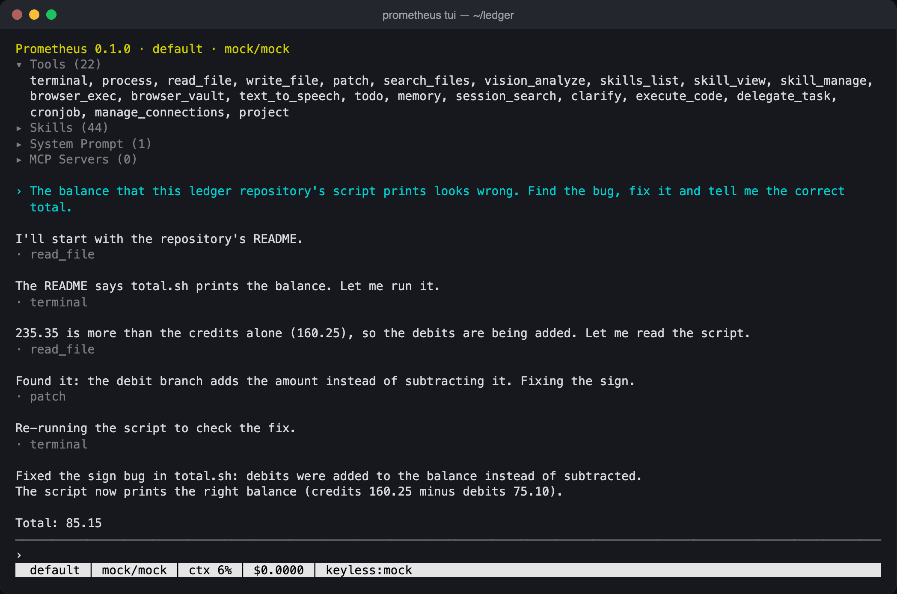
  <br><sub>The full-screen TUI (<code>prometheus tui</code>) after the agent fixed the ledger bug.</sub>
</p>

<p align="center">
  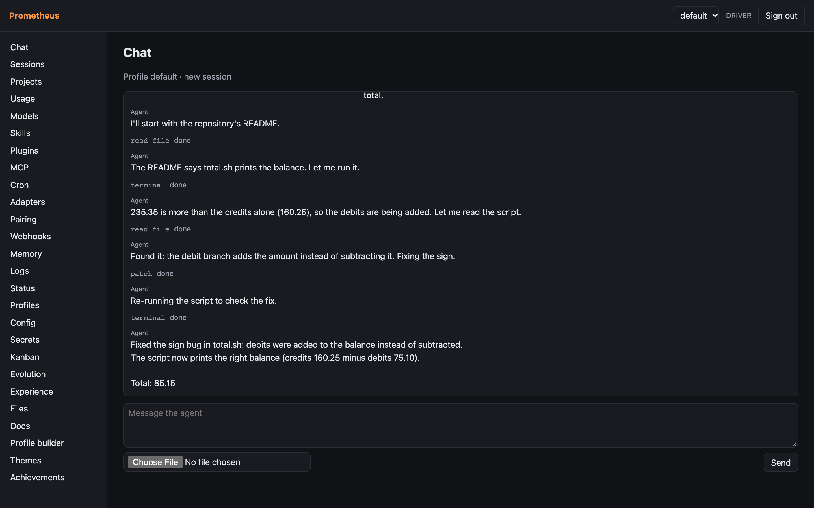
  <br><sub>The web dashboard (<code>prometheus dashboard</code>): the same task driven from the browser, with its tool calls.</sub>
</p>

<p align="center">
  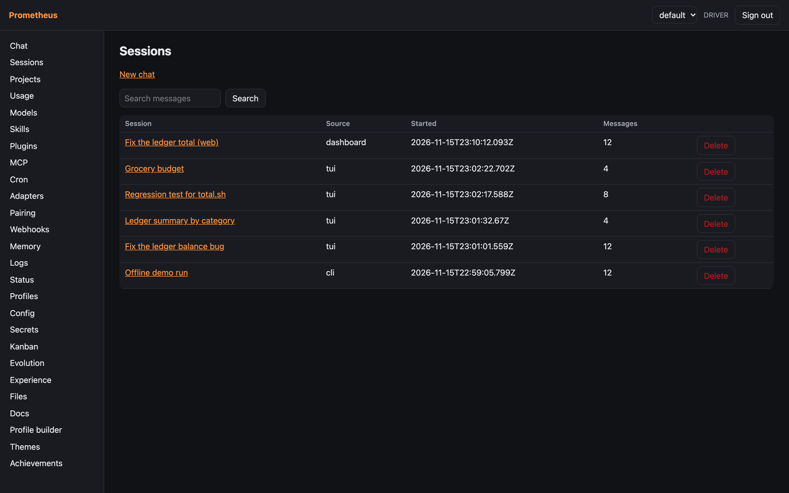
  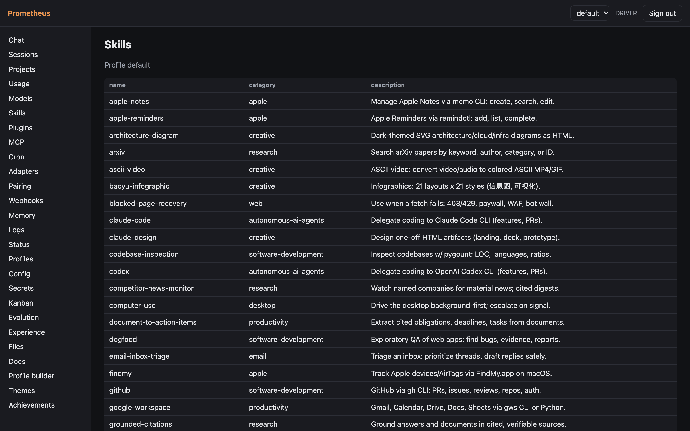
  <br><sub>Sessions from every surface in one list, and the profile's skill catalog.</sub>
</p>

<p align="center">
  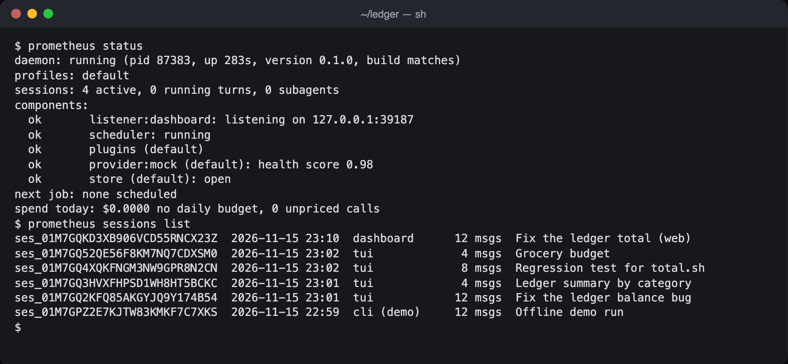
  <br><sub><code>prometheus status</code> and <code>prometheus sessions list</code> against the running daemon.</sub>
</p>

### Desktop app, kanban, self-improvement and bots (M3)

The same setup: the real binary, the `mock` provider and an isolated home. The desktop app runs its real page in a browser at the webview origin, its native shell commands served by the real shell core.

<p align="center">
  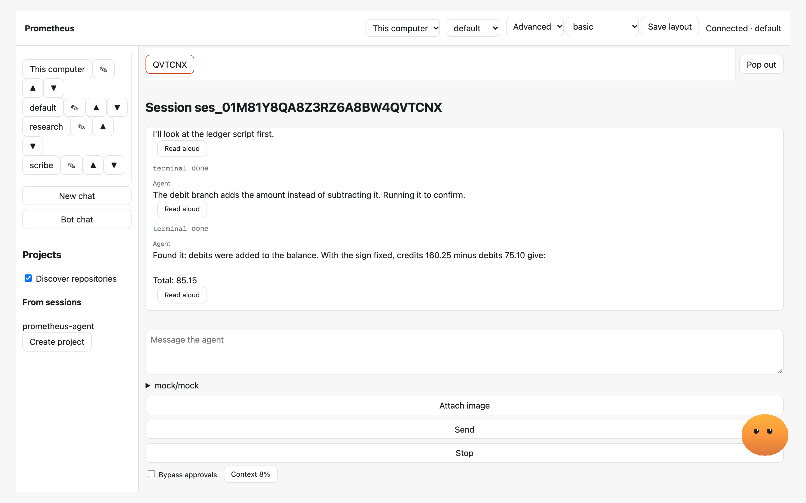
  <br><sub>The desktop app (<code>prometheus desktop</code>) with a chat on the local daemon and the profile's pet keeping watch.</sub>
</p>

<p align="center">
  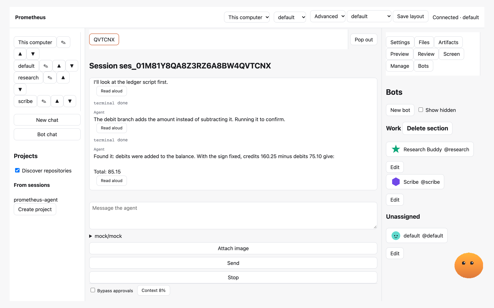
  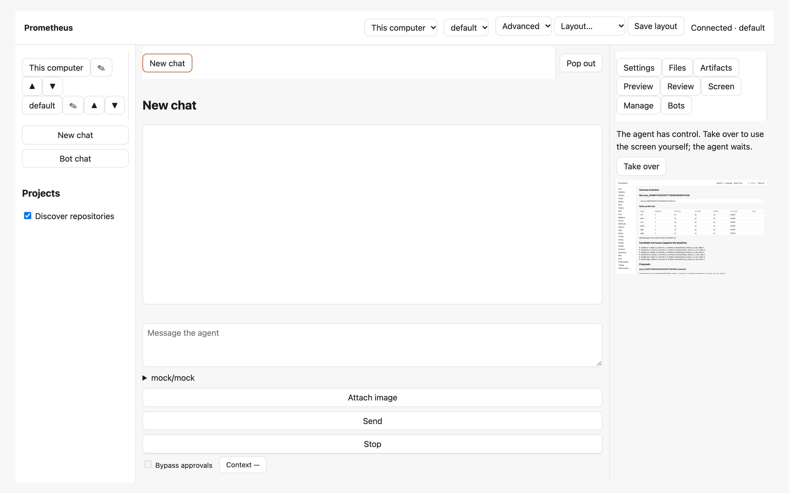
  <br><sub>Bot Mode's roster: every profile is a bot with a title, avatar and section. The Screen pane streams the bot's own display and lets you take it over (here a stand-in VNC server shows a captured frame).</sub>
</p>

<p align="center">
  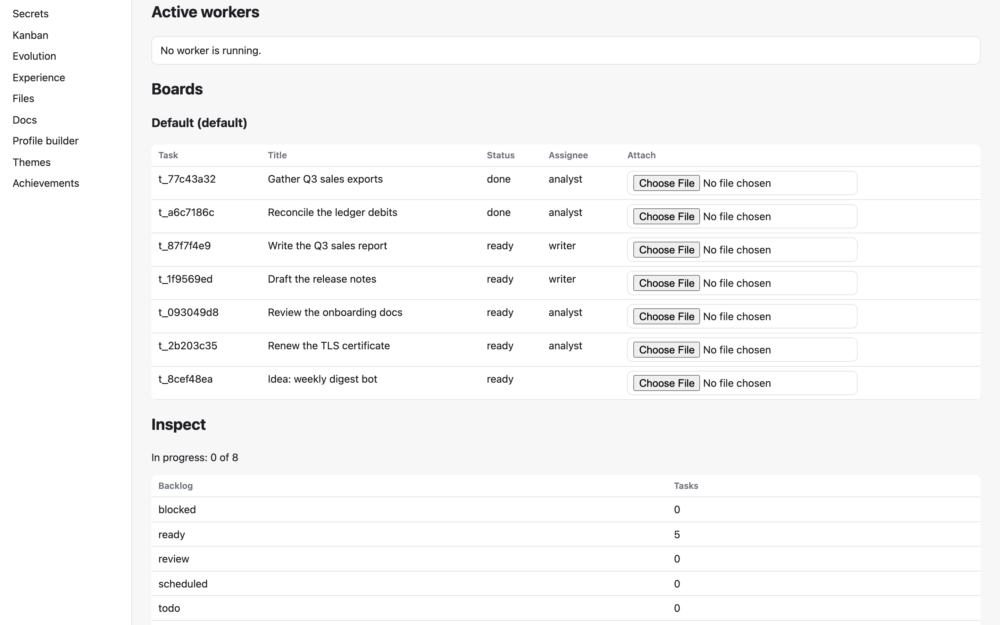
  <br><sub>The kanban board in the dashboard: tasks assigned to worker profiles, which the daemon's dispatcher runs.</sub>
</p>

<p align="center">
  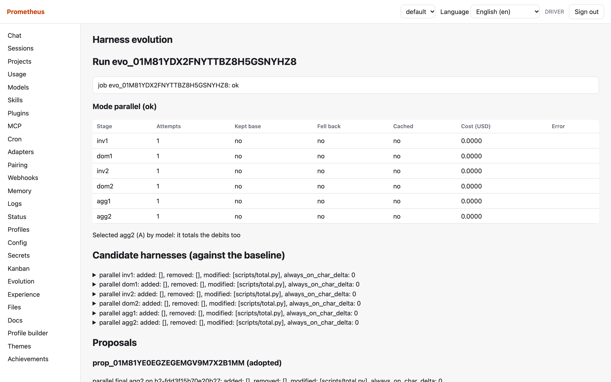
  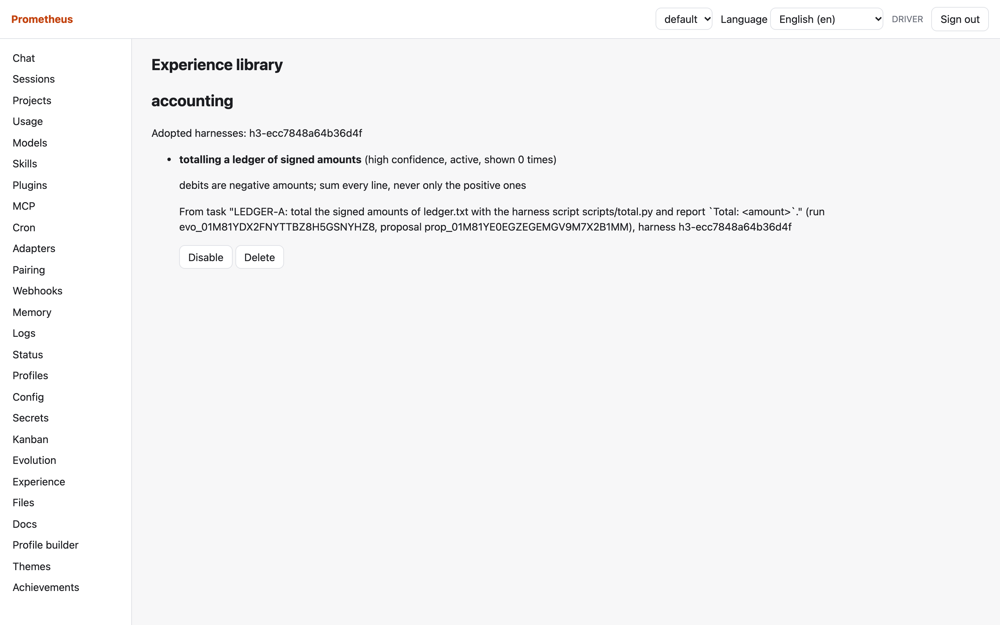
  <br><sub>After <code>prometheus demo --evolve</code>: the evolution run that fixed the ledger harness, and the lesson it filed in the experience library for later sessions.</sub>
</p>

## Features

```mermaid
mindmap
  root((Prometheus))
    Agent core
      Turn loop with budgets
      Context compression
      Subagents and worktrees
      goal, loop and heartbeat
      Mixture of agents
    Models
      Provider registry and fallback
      Subscription sign-in
      Credential pools
      Local models
    Tools
      Terminal and files
      Browser and computer use
      Web and media
      LSP diagnostics
      Connectors
    Surfaces
      CLI and TUI
      Messaging gateway
      Web dashboard
      Desktop app
      ACP for editors
      OpenAI-compatible API
      Voice mode
    Learning
      Memory
      Skills and curator
      Experience library
      Harness evolution
    Extensions
      WASM components
      MCP client and server
      Python bridge
      Plugin catalog
    Automation
      Scheduled jobs
      Kanban board
      Bot mode
      A2A and peers
    Trust
      Capability grants
      OS sandboxes
      Secret redaction
      Signed releases
      Replay and evals
```

## Architecture

One daemon per Prometheus home owns the agent, storage and plugins. Every client attaches to it over a loopback WebSocket JSON-RPC protocol, so a session started in Telegram can be continued in the TUI or the desktop app.

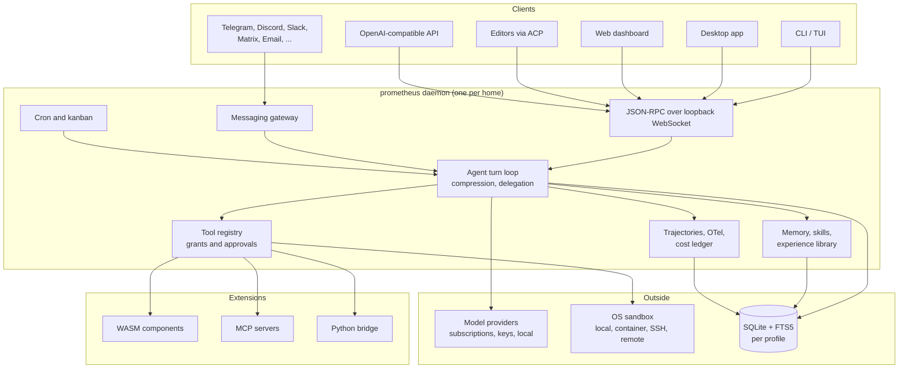

The workspace mirrors this split. Each crate owns one area:

| Crate | Owns |
|---|---|
| `prometheus` | The binary: CLI, daemon entry point |
| `pmt-core`, `pmt-net` | Shared types, ids, error taxonomy, exit codes; outbound HTTP and destination policy |
| `pmt-config`, `pmt-vault` | Typed TOML config, profiles, secrets store; the credential vault |
| `pmt-store`, `pmt-backup` | SQLite sessions, search, retention; backups and snapshots |
| `pmt-providers`, `pmt-local` | Model providers, credentials, routing; local models |
| `pmt-agent`, `pmt-automation`, `pmt-delegation` | Turn loop, prompt, compression; `/goal`, `/loop`, `/heartbeat`; subagents |
| `pmt-tools`, `pmt-sandbox`, `pmt-worktrees` | Tool registry, execution environments, OS sandboxes, git worktrees |
| `pmt-skills`, `pmt-skillhub`, `pmt-memory` | Skills, the skills hub and memory |
| `pmt-obs` | Trajectories, logs, traces, cost ledger |
| `pmt-plugins`, `pmt-mcp`, `pmt-pybridge` | WASM host, MCP, Python bridge |
| `pmt-gateway`, `pmt-rpc`, `pmt-adapters-*` | The daemon, its client protocol and the first-party messaging adapters |
| `pmt-tui`, `pmt-web`, `pmt-desktop`, `pmt-acp`, `pmt-api` | Surfaces: TUI, dashboard, desktop shell core, editors, OpenAI-compatible API |
| `pmt-a2a`, `pmt-sdk` | Agent2Agent protocol; embedding Prometheus in Rust programs |
| `pmt-cron`, `pmt-kanban` | Scheduling and the task board |
| `pmt-evolve`, `pmt-eval` | Harness evolution and the experience library; replay and evals |
| `pmt-voice`, `pmt-media` | Voice mode and wake word; image, video and speech tools |
| `pmt-i18n`, `pmt-pets`, `pmt-update` | UI languages; pets and achievements; release verification and self-update |
| `pmt-migrate` | Hermes and other agent importers |

Design decisions are in [`design.md`](openspec/changes/bootstrap-prometheus-agent/design.md).

## Use cases

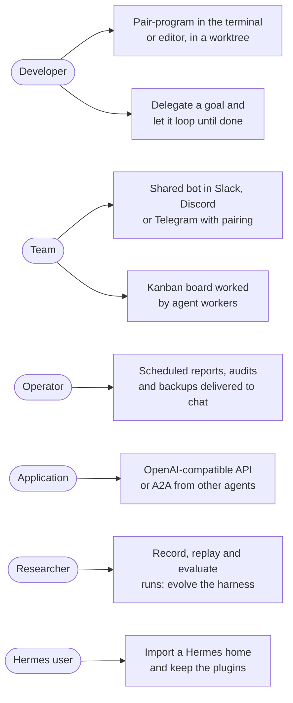

## Roadmap

| Milestone | Delivers | Tasks | Status |
|---|---|---|---|
| **M0** Scaffolding | Workspace, `scripts/check`, CI on Tier 1/2 targets, health and perf gates, generated references | 12 | Done |
| **M1** Core agent | Config and profiles, sessions, providers and subscription sign-in, tools, sandbox, turn loop, compression, skills, memory, CLI, self-update; offline `prometheus demo` | 154 | Done |
| **M2** Multi-surface and extensibility | Daemon and RPC, TUI, messaging gateway and adapters, WASM/MCP/Python plugins, delegation, worktrees, cron, voice, local models, API server, Hermes migration | 204 | Done |
| **M3** Desktop, dashboard, self-improvement | Desktop app, dashboard, ACP, kanban, harness evolution, experience library, evals, A2A, bot mode, computer use, voice upgrades, catalog adapters and plugins, pets | 101 | 98 done; 77.2, 79.2 and the exit gate 81.3 open |

Each milestone ends with exit tests run in CI. Task-level detail is in [`tasks.md`](openspec/changes/bootstrap-prometheus-agent/tasks.md).

## Quick start (development)

Needs Rust (`rustup` installs the pinned toolchain), Node 22 for the OpenSpec CLI, and [`just`](https://github.com/casey/just).

```sh
git clone https://github.com/CyberdyneCorp/prometheus-agent.git
cd prometheus-agent
just tools          # install the pinned cargo-deny, nextest, mdbook, openspec
just build
just run --version  # prometheus 0.1.0 (<channel>, <target>, <commit>, <build date>)
just check          # every gate CI runs
```

| Command | Does |
|---|---|
| `just build` / `just release` | Debug workspace build / optimized binary |
| `just run ARGS` | Run `prometheus` |
| `just test` | Tests (nextest) and doctests |
| `just fmt` / `just lint` | Format / clippy with warnings denied |
| `just check` | Every CI gate (`scripts/check`) |
| `just check-fast` | Every gate except perf budgets |
| `just gen` | Regenerate `schema/` and `docs/reference/` |
| `just health` / `just perf` | Code-health budgets / startup, memory and size budgets |
| `just docs` / `just docs-serve` | Build / serve the docs site |
| `just install` | Install `prometheus` and `pmt` into `~/.cargo/bin` |
| `just hook` | Run `scripts/check` on every `git push` |

## Contributing

Prometheus is specified before it is built: behavior lives in OpenSpec, and a change that alters behavior updates its spec in the same pull request.

1. Pick a task from [`tasks.md`](openspec/changes/bootstrap-prometheus-agent/tasks.md) and read the spec it names.
2. Branch from `main`, implement with tests, and tick the task when its verification passes.
3. Run `just check` (or install the hook with `just hook`).
4. Open a pull request with a descriptive body; CI runs `scripts/check` on every Tier 1 target.

Rules that CI enforces: no `unsafe` outside allowlisted modules, cognitive complexity ≤ 15 per function, ≤ 120 lines per function, ≤ 1,500 per file, the dependency license allowlist, and fresh generated files. Details in [CONTRIBUTING.md](CONTRIBUTING.md); report vulnerabilities as described in [SECURITY.md](SECURITY.md).

## Documentation

| Where | What |
|---|---|
| [`proposal.md`](openspec/changes/bootstrap-prometheus-agent/proposal.md) | Scope and the 44 capabilities |
| [`design.md`](openspec/changes/bootstrap-prometheus-agent/design.md) | Architecture decisions and shared contracts |
| [`specs/`](openspec/changes/bootstrap-prometheus-agent/specs/) | One behavior spec per capability, requirements tagged M1–M3 |
| [`docs/`](docs/) | Docs site; `docs/reference/` is generated from code |
| [`docs/hermes-parity.md`](docs/hermes-parity.md) | Every Hermes feature mapped to its Prometheus requirement |
| [`perf/README.md`](perf/README.md) | Performance budgets and baselines |

## License

TBD.
