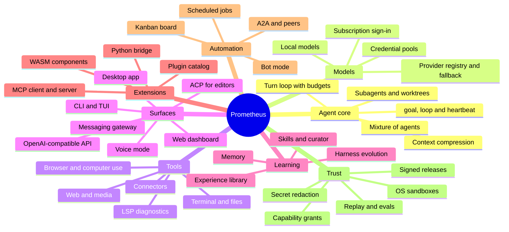
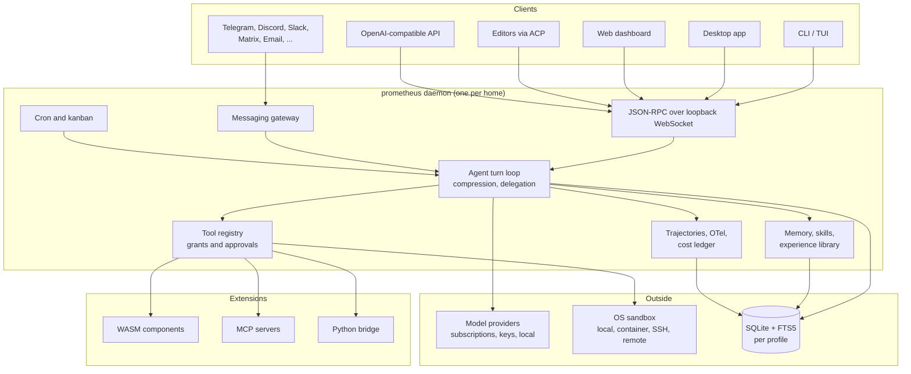
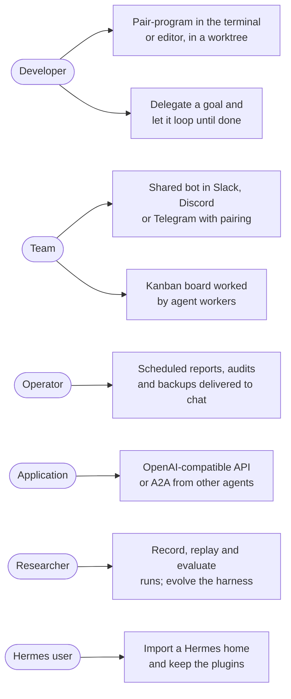

# Prometheus Agent

A personal and team AI agent harness in Rust, by CyberdyneCorp.

One agent core runs behind every surface: CLI, full-screen TUI, messaging gateway, web dashboard, editor integration (ACP), an OpenAI-compatible API and a desktop app. It remembers across sessions, writes and reuses skills, delegates to subagents, runs scheduled jobs, drives a real terminal and browser inside OS sandboxes, and can refine its own harness through a budgeted Propose–Probe–Compose loop.

It ships as one signed binary, `prometheus` (alias `pmt`). Extensions run as sandboxed WebAssembly components with explicit capability grants, as MCP servers, or as existing Hermes Python plugins through an out-of-process bridge.

> **Status: M0 done, M1 next.** The workspace, the repository gates and CI exist; agent behavior starts in M1. The full target behavior is specified in [`openspec/changes/bootstrap-prometheus-agent/`](openspec/changes/bootstrap-prometheus-agent/).

## Why Prometheus

| | |
|---|---|
| **Fast and small** | Native binary, startup budget 20 ms, no Python or Node runtime required |
| **Safe extensions** | WASM plugins only get the capabilities you grant; local commands run under Landlock/seccomp, Seatbelt or AppContainer |
| **Your subscriptions** | Claude Max, ChatGPT/Codex, SuperGrok, Nous Portal and more by sign-in, or API keys, or local models |
| **Self-improving** | Memory, skills, an experience library and answer-free harness evolution |
| **Reproducible** | Every model call can be recorded and replayed; offline mock provider and eval suites |
| **Hermes-compatible** | Imports a Hermes home and runs Hermes plugins and skills; [every Hermes feature](docs/hermes-parity.md) is mapped |

## Features



## Architecture

One daemon per Prometheus home owns the agent, storage and plugins. Every client attaches to it over a loopback WebSocket JSON-RPC protocol, so a session started in Telegram can be continued in the TUI or the desktop app.



The workspace mirrors this split. Each crate owns one area:

| Crate | Owns |
|---|---|
| `prometheus` | The binary: CLI, daemon entry point |
| `pmt-core` | Shared types, ids, error taxonomy, exit codes |
| `pmt-config` | Typed TOML config, profiles, secrets store |
| `pmt-store` | SQLite sessions, search, retention |
| `pmt-providers` | Model providers, credentials, routing |
| `pmt-agent` | Turn loop, prompt, compression |
| `pmt-tools`, `pmt-sandbox` | Tool registry, execution environments, OS sandboxes |
| `pmt-skills`, `pmt-memory` | Skills and memory |
| `pmt-obs` | Trajectories, logs, traces, cost ledger |
| `pmt-plugins`, `pmt-mcp`, `pmt-pybridge` | WASM host, MCP, Python bridge |
| `pmt-gateway`, `pmt-tui`, `pmt-web`, `pmt-acp` | Surfaces |
| `pmt-cron`, `pmt-kanban` | Scheduling and the task board |
| `pmt-evolve`, `pmt-eval` | Harness evolution, replay and evals |
| `pmt-migrate` | Hermes and other agent importers |

Design decisions are in [`design.md`](openspec/changes/bootstrap-prometheus-agent/design.md).

## Use cases



## Roadmap

| Milestone | Delivers | Tasks | Status |
|---|---|---|---|
| **M0** Scaffolding | Workspace, `scripts/check`, CI on Tier 1/2 targets, health and perf gates, generated references | 12 | Done |
| **M1** Core agent | Config and profiles, sessions, providers and subscription sign-in, tools, sandbox, turn loop, compression, skills, memory, CLI, self-update; offline `prometheus demo` | 154 | Next |
| **M2** Multi-surface and extensibility | Daemon and RPC, TUI, messaging gateway and adapters, WASM/MCP/Python plugins, delegation, worktrees, cron, voice, local models, API server, Hermes migration | 204 | Planned |
| **M3** Desktop, dashboard, self-improvement | Desktop app, dashboard, ACP, kanban, harness evolution, experience library, evals, A2A, bot mode, computer use | 101 | Planned |

Each milestone ends with exit tests run in CI. Task-level detail is in [`tasks.md`](openspec/changes/bootstrap-prometheus-agent/tasks.md).

## Quick start (development)

Needs Rust (`rustup` installs the pinned toolchain), Node 22 for the OpenSpec CLI, and [`just`](https://github.com/casey/just).

```sh
git clone https://github.com/CyberdyneCorp/prometheus-agent.git
cd prometheus-agent
just tools          # install the pinned cargo-deny, nextest, mdbook, openspec
just build
just run --version  # prometheus 0.1.0 (<target>, <commit>)
just check          # every gate CI runs
```

| Command | Does |
|---|---|
| `just build` / `just release` | Debug workspace build / optimized binary |
| `just run ARGS` | Run `prometheus` |
| `just test` | Tests (nextest) and doctests |
| `just fmt` / `just lint` | Format / clippy with warnings denied |
| `just check` | Every CI gate (`scripts/check`) |
| `just check-fast` | Every gate except perf budgets |
| `just gen` | Regenerate `schema/` and `docs/reference/` |
| `just health` / `just perf` | Code-health budgets / startup, memory and size budgets |
| `just docs` / `just docs-serve` | Build / serve the docs site |
| `just install` | Install `prometheus` and `pmt` into `~/.cargo/bin` |
| `just hook` | Run `scripts/check` on every `git push` |

## Contributing

Prometheus is specified before it is built: behavior lives in OpenSpec, and a change that alters behavior updates its spec in the same pull request.

1. Pick a task from [`tasks.md`](openspec/changes/bootstrap-prometheus-agent/tasks.md) and read the spec it names.
2. Branch from `main`, implement with tests, and tick the task when its verification passes.
3. Run `just check` (or install the hook with `just hook`).
4. Open a pull request with a descriptive body; CI runs `scripts/check` on every Tier 1 target.

Rules that CI enforces: no `unsafe` outside allowlisted modules, cognitive complexity ≤ 15 per function, ≤ 120 lines per function, ≤ 1,500 per file, the dependency license allowlist, and fresh generated files. Details in [CONTRIBUTING.md](CONTRIBUTING.md); report vulnerabilities as described in [SECURITY.md](SECURITY.md).

## Documentation

| Where | What |
|---|---|
| [`proposal.md`](openspec/changes/bootstrap-prometheus-agent/proposal.md) | Scope and the 44 capabilities |
| [`design.md`](openspec/changes/bootstrap-prometheus-agent/design.md) | Architecture decisions and shared contracts |
| [`specs/`](openspec/changes/bootstrap-prometheus-agent/specs/) | One behavior spec per capability, requirements tagged M1–M3 |
| [`docs/`](docs/) | Docs site; `docs/reference/` is generated from code |
| [`docs/hermes-parity.md`](docs/hermes-parity.md) | Every Hermes feature mapped to its Prometheus requirement |
| [`perf/README.md`](perf/README.md) | Performance budgets and baselines |

## License

TBD.
